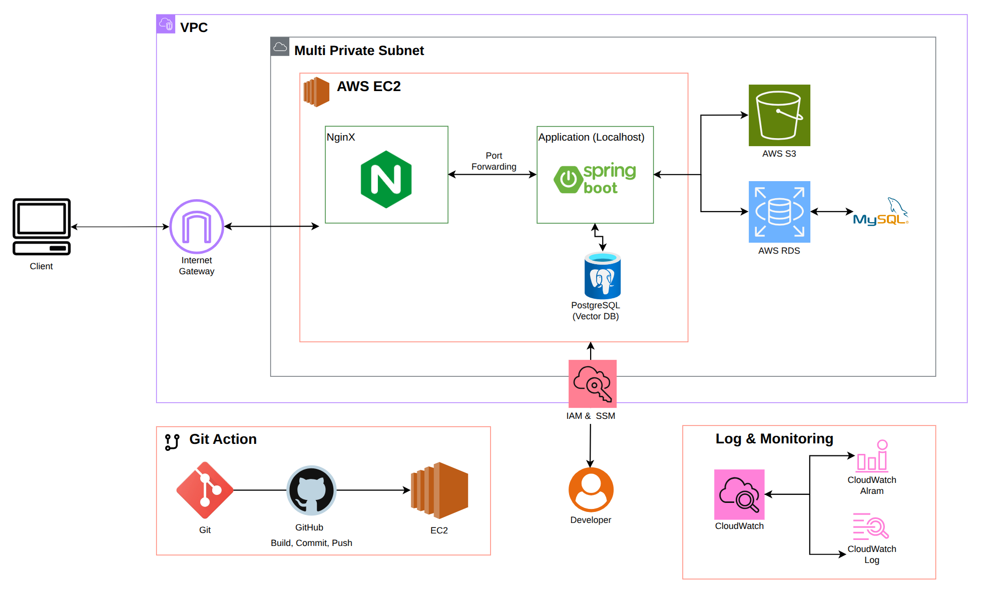
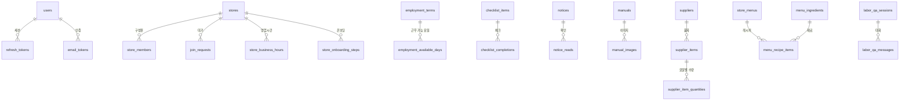

<div align="center">

# ToTheWork

**자영업자들을 위한, 간편한 매장 및 인력 관리 서비스**

<br>


<br>

### [🔗 tothework.com](https://tothework.com)

<sub>API 서버 · <code>api.tothework.com</code></sub>

<br>

[개발 배경](#개발-배경) · [핵심 기능](#핵심-기능) · [차별점](#차별점) · [기존 구조와의 차이](#기존-구조와-무엇이-다른가) · [기술 스택](#기술-스택) · [아키텍처](#아키텍처) · [모듈 구조](#모듈-구조) · [ERD](#erd) · [설계 포인트](#주요-설계-포인트) · [API](#api-개요) · [실행](#로컬-실행)

</div>

---

## 개발 배경

### 문제

주휴수당, 연장·야간·휴일 가산수당, 연소자 야간근로 제한, 5인 미만 사업장 특례.
직원을 두고 매장을 운영하는 자영업자가 **매달 부딪히지만 정확히 계산하기는 어려운** 것들이다.

계산이 어려운 이유는 규칙이 복잡해서만이 아니다. 조건이 서로 얽혀 있다.

- 주 15시간을 넘겼는가 → 주휴수당이 생긴다
- 매장 인원이 5인 미만인가 → 연장·야간 가산수당이 적용되지 않는다
- 직원이 만 18세 미만인가 → 1일 7시간·주 35시간 상한과 야간근로 금지가 붙는다

이 조건들은 **근무가 끝난 뒤가 아니라 스케줄을 짤 때** 확인돼야 의미가 있다.
월급날에 "이번 달 주휴수당이 발생했습니다"를 아는 것은 이미 늦다.

### 왜 기존 서비스로는 부족한가

근태 관리 서비스는 이미 여럿 있고, 무료 요금제도 존재한다.
그래서 **"무료"만으로는 차별화가 되지 않는다**고 판단했다.

기존 서비스 다수는 다점포·프랜차이즈를 기본 전제로 설계돼 있다.
본사가 지점에 업무를 지시하고, QSC 점검 결과를 취합하고, 여러 지점의 인건비를 비교하는 구조다.

매장 하나를 직접 운영하는 자영업자에게는 그 층위가 통째로 불필요하다.
사장님이 곧 관리자이고, 지시할 본사도 비교할 지점도 없다.
필요한 것은 **이번 주 스케줄이 법에 걸리는지 지금 알려주는 것** 하나다.

### 두 축

그래서 두 가지에 집중했다.

| 축 | 내용 |
|---|---|
| **준법 자동화의 깊이** | 주휴·연장·야간·휴일 가산, 연소자 보호, 5인 미만 분기, 4대보험·소득세 공제까지 서버가 계산한다 |
| **알바생 경험** | 알바생이 자기 예상 월급을 직접 본다. 사장님이 도입하지 않아도 알바생이 먼저 쓰고 싶어지는 쪽을 노린다 |

두 번째 축은 유입 경로이기도 하다.
급여 관리 도구는 보통 사장님이 고르지만, 이 구조에서는 **알바생이 사장님에게 역제안**할 수 있다.

<!--
시장 조사 수치를 넣을 자리.
예: 자영업자·소상공인 사업체 수, 주휴수당 위반·최저임금 미만율 통계, 임금체불 규모 등
출처와 함께 추가할 것. 확인되지 않은 수치는 넣지 않는다.
-->

---

## 핵심 기능

<!--
스크린샷 자리. docs/images/ 에 파일을 넣고 아래 주석을 이미지 문법으로 교체할 것.
권장: home.png / schedule.png / payroll.png / labor-qa.png / dashboard.png
-->

### 매장 홈 — 역할에 따라 다른 화면

<!--  -->

같은 엔드포인트(`GET /stores/{storeId}/home`)가 역할에 따라 응답의 구성을 바꾼다.

**모두가 받는 부분** — 오늘 내 근무, 출근 중인지 여부, 안 읽은 공지 수,
오픈·마감 체크리스트 진행률, 최근 인수인계 노트, **이번 달 예상 실수령액**.

**사장·매니저에게만 덧붙는 부분** — 오늘 근무자 명단, 오늘 발주할 품목,
이번 달 인건비와 실지급액 합계, 대기 중인 참여 신청 수.

화면마다 API를 따로 두지 않은 이유는, 홈에 필요한 집계가 역할별로 다를 뿐
**한 화면을 그리는 데 필요한 왕복 횟수는 하나여야 하기 때문**이다.

### 스케줄 — 짜는 순간에 막는다

<!--  -->

스케줄을 저장하기 전에 검사한다.

- 같은 사람의 근무 시간이 겹치는가
- 그 직원의 근무 가능 요일인가
- 연소자라면 1일 7시간·주 35시간 상한, 야간(22:00~06:00)·주휴일 근로 금지에 걸리는가
- 영업시간을 벗어나는가

반복 스케줄(`POST /shifts/recurring`)과 근무유형 템플릿을 지원하고,
AI 초안(`POST /shifts/ai-draft`)은 인원·영업시간·근무 가능 요일을 받아 한 주치를 제안한다.
초안은 **확정 전까지 저장되지 않으며**, 확정 시 각 항목이 개별적으로 검증된다.

### 출퇴근 — 한 번만 출근한다

<!--  -->

출근 버튼이 연타되거나 요청이 중복돼도 근무 중 기록은 한 사람당 하나만 남는다.
이것을 애플리케이션 검사가 아니라 **DB 유니크 제약**으로 보장한다 ([설계 포인트](#동시성은-db-제약으로-끝낸다) 참고).

지각·조퇴·결근은 스케줄과 실제 기록을 대조해 자동 판정된다.

### 급여 — 알바생이 먼저 본다

<!--  -->

| | |
|---|---|
| **예상 월급** | 확정된 근태 + 남은 스케줄로, 아직 끝나지 않은 달을 추정한다 |
| **임금명세서** | 기본급·주휴·연장·야간·휴일근로수당·연차수당을 항목별로 산출하고, 공제 후 실수령액까지 낸다 |
| **공제 방식 선택** | 멤버마다 `NONE` / `3.3% 원천징수` / `4대보험` 중 하나를 고른다 |
| **5인 미만 분기** | 매장 설정 하나로 가산수당 적용 여부가 갈린다 |

### 주간 대시보드 — 넘기기 전에 보인다

<!--  -->

주 52시간과 주휴 15시간을 **넘긴 뒤 알리지 않는다.** 근접하면 대시보드에 나타난다.
일별·주별·월별 인건비와 근무시간을 함께 본다.

### AI 근로 상담

<!--  -->

근로기준법 문서를 pgvector에 임베딩해두고 RAG로 답한다.

**매장에 속하지 않은 사용자도 물어볼 수 있다.** 이 도메인만 `storeId`를 받지 않고 `userId`만 받는다 —
알바를 시작하기 전에, 혹은 이미 그만둔 뒤에 확인하고 싶은 것이 있기 때문이다.
대화는 세션으로 이어지고, 세션은 **만든 사람만** 열어볼 수 있다.

AI 엔드포인트에는 호출 제한이 걸려 있다(`shared/ratelimit`). 비용이 사용자 입력에 비례하기 때문이다.

설명과 숫자를 다르게 다루는 이유는 [설계 포인트](#ai-상담은-설명과-숫자를-다르게-다룬다)에 적었다.

### 매장 운영

| 기능 | 내용 |
|---|---|
| **체크리스트** | 오픈·마감 항목, 누가 언제 체크했는지 기록 |
| **공지** | 누가 읽었는지 확인 현황까지 |
| **인수인계 노트** | 교대 시 남기는 메모 |
| **매뉴얼** | 이미지를 포함한 매장 매뉴얼 |
| **거래처·발주** | 거래처별 품목과 발주 수량 |
| **원가 계산** | 재료 단가 → 레시피 → 메뉴 원가율. 단가는 **로스율을 반영**해 `구매가 ÷ (용량 × (1 − 로스율))`로 낸다. 원가·이익은 민감정보라 OWNER/MANAGER 전용 |

---

## 차별점

| | 일반적인 근태 서비스 | ToTheWork |
|---|---|---|
| **대상** | 다점포·프랜차이즈 | 매장을 직접 운영하는 자영업자 |
| **법 계산** | 근무 시간 집계까지 | 주휴·가산·연소자·5인 미만 분기까지 |
| **위반 인지 시점** | 정산할 때 | 스케줄 짤 때 |
| **알바생의 위치** | 기록되는 대상 | 자기 급여를 직접 보는 사용자 |
| **법령 질의** | 없음 | RAG 기반 상담, 비소속자도 가능 |

---

## 기존 구조와 무엇이 다른가

같은 기능, 같은 API(117개)를 두 가지 구조로 담고 있다. [`layered`](https://github.com/kiddo-dong/tothework/tree/layered)
브랜치가 출발점인 레이어드 구조이고, `main`이 그것을 모듈러 모놀리스로 다시 지은 결과다.

| | `layered` | `main` |
|---|---|---|
| 빌드 | Maven 단일 모듈 | Gradle 멀티 프로젝트 — 서비스마다 `api`·`core` |
| 패키지 | `domain/<기능>/{controller,service,repository,entity,dto}` 16개 + 공용 `global` | `<서비스>/api`(계약) · `<서비스>/core`(구현) |
| 경계 | 없음. 어느 기능이든 다른 기능의 엔티티·저장소를 쓸 수 있다 | 다른 서비스의 `core` 의존은 빌드 설정 단계에서 실패 |
| 영속성 | JPA, 엔티티 사이 연관관계(`StoreMember → Store → …`) | Spring Data JDBC, 애그리거트 사이는 id 참조 |
| DB | 한 스키마(`al-bam`), 테이블 사이 외래키·CASCADE·JOIN | 서비스마다 스키마(`tw_*`), 서비스를 넘는 외래키·JOIN 없음 |
| 서비스 간 협력 | 다른 기능의 서비스·엔티티 직접 호출, 같은 트랜잭션 | `api`의 인터페이스·레코드, 비동기 이벤트(발행 기록 저장) |

처음에는 `layered` 코드를 그 자리에서 고치려 했다. Spring Modulith로 기능 사이 경계를 재 보니 위반이 962건(순환
27건)이었고, 이를 0건까지 줄였다. 그런데 나중에 떼어 낼 서비스 단위로 다시 재니 다른 서비스의 엔티티·저장소를
직접 쓰는 곳이 326건 남아 있었다. 대부분 아래 결합 때문이라 제자리 리팩토링으로는 계속 타협하게 되어 다시 지었다.

- **한 엔티티에 두 서비스의 데이터.** `StoreMember`에 소속(역할·상태)과 고용 조건(시급·공제·주휴일)이 함께 있었다.
  `main`에서는 소속은 `store`, 고용 조건은 `workforce`가 같은 memberId로 따로 갖는다.
- **다른 서비스의 행을 잠그는 동시성 제어.** 스케줄 쓰기를 줄 세우려고 store의 소속 행을 잠갔다. `main`에서는
  workforce가 가진 고용 조건 행을 잠근다.
- **서비스를 넘는 외래키·CASCADE·JOIN.** 예를 들어 매장 삭제가 CASCADE로 근태·급여까지 지웠다. `main`에서는 store가
  삭제 이벤트를 내고 각 서비스가 자기 데이터를 지운다.

다시 지으며 찾아 고친 문제(같은 1초에 발급한 토큰이 똑같아지는 버그, 동시 요청의 교착, 목록 API의 N+1 등)는 각
설계 문서에 있다. 기존 DB는 [migration/](migration/README.md)의 스크립트로 옮긴다.

---

## 기술 스택

| 분류 | 사용 기술 | 선택 이유 |
|---|---|---|
| **언어·런타임** | Java 25 | |
| **프레임워크** | Spring Boot 4.1, Spring Modulith 2.1 | 서비스 간 이벤트와 발행 기록, 모듈 순환 검사 |
| **빌드** | Gradle 9 (Kotlin DSL, convention plugin) | 서비스 경계를 빌드 단계에서 강제 |
| **영속성** | Spring Data JDBC, Flyway | 애그리거트 사이를 id로만 참조. 스키마는 서비스마다 마이그레이션 |
| **업무 DB** | MySQL 8 — 서비스마다 스키마 | 테이블 소유권을 서비스 단위로 |
| **벡터 DB** | PostgreSQL 16 + pgvector 0.6 | 근로기준법 문서 임베딩 검색 |
| **AI** | Spring AI 2.0, OpenAI `gpt-4.1-mini`, `text-embedding-3-small` | 임베딩 1536차원 |
| **인증** | JWT (jjwt), OAuth2 | 리프레시 토큰은 DB에 해시로 보관 |
| **스토리지** | AWS S3 | 프로필·매뉴얼 이미지 |
| **테스트** | JUnit 5, Testcontainers, ArchUnit, datasource-proxy | 실제 MySQL·경계 규칙·쿼리 수 |

영속성은 JPA 대신 **Spring Data JDBC**를 쓴다. 지연 로딩·변경 감지·프록시가 없어 엔티티를 타고 다른 서비스로
결합이 새어 나갈 수 없다. 목록처럼 자식 컬렉션을 여러 루트에 걸쳐 읽는 곳은 SQL을 직접 쓴다
([N+1 참고](#n1은-리더로-막고-테스트로-잡는다)).

### 인프라 · 배포

| 분류 | 사용 기술 | 비고 |
|---|---|---|
| **서버** | AWS EC2 (`ap-northeast-2`) | 앱 + PostgreSQL을 한 인스턴스에 둔다 |
| **DB** | AWS RDS (MySQL 8) | 업무 데이터. 자동 백업·유지보수 창 위임 |
| **스토리지** | AWS S3 | 프로필·매장·매뉴얼 이미지. key로 저장하고 URL은 조립 |
| **모니터링** | Amazon CloudWatch | EC2 기본 지표(CPU·네트워크·디스크) + **CloudWatch Agent로 로그 수집** |
| **프로세스 관리** | systemd | 전용 계정으로 실행, 부팅 시 자동 기동, 시크릿은 `EnvironmentFile` |
| **리버스 프록시** | nginx | TLS 종료, `127.0.0.1:8080`으로 전달 |
| **인증서** | Let's Encrypt (certbot) | `--nginx` 플러그인으로 발급·자동 갱신 |
| **프론트엔드** | Vercel | [`tothework.com`](https://tothework.com) |
| **운영 상태** | Spring Boot Actuator | `health`·`info`·`metrics`·`loggers`, **8081 루프백 전용** |
| **로그** | Logback 파일 롤링 + journalctl | 50MB 단위, 30일 보관, 총 1GB 상한 |

**두 포트를 나눈 이유** — Actuator의 `loggers`는 **로그 레벨을 런타임에 바꾸는 쓰기 엔드포인트**다.
외부에 열리면 안 되는데, 인증을 붙이는 것보다 **아예 루프백에만 바인딩하는 쪽**이 확실하다.
nginx가 8081을 프록시하지 않으므로, 상태 확인은 서버에 들어가서만 가능하다.

**로그를 두 곳에 쌓는 이유** — 인스턴스 안에는 Logback이 파일로 남기고, CloudWatch Agent가 같은 로그를
밖으로 보낸다. 파일만 있으면 **인스턴스를 잃는 순간 장애 직전의 로그도 함께 사라진다.**
반대로 로컬 파일이 있어야 SSH로 들어가 바로 `tail`할 수 있다.

**로그 상한을 건 이유** — 작은 인스턴스에서 로그가 디스크를 채우면 앱이 아니라 **서버가 죽는다.**
총량 상한이 있어야 최악의 경우가 "오래된 로그 유실"에서 멈춘다.

---

## 아키텍처



애플리케이션은 **127.0.0.1에만 바인딩**되고, Actuator는 8081 루프백 전용이라 nginx가 프록시하지 않는다.
외부에서 접근 가능한 경로는 nginx를 통과한 것뿐이다.

---

## 모듈 구조

### 서비스 후보

배포 단위는 하나이고, 나중에 서비스로 떼어 낼 단위마다 코드·스키마·마이그레이션을 따로 둔다.

| 서비스 | 성격 | 스키마 |
|---|---|---|
| `identity` | 가입·인증·프로필 | `tw_identity` |
| `store` | 매장·소속·권한·가입 승인 | `tw_store` |
| `workforce` | 스케줄·근태·연차·급여·고용 조건 | `tw_workforce` |
| `operations` | 체크리스트·공지·인수인계·매뉴얼·거래처·메뉴 | `tw_operations` |
| `laborqa` | AI 근로 상담 | `tw_laborqa` (+ 벡터 DB) |
| `bff` | 화면용 조합 API(홈, 멤버 상세). 서비스가 아니다 | 없음 |

```
<service>/api    서비스 간 계약 — 레코드·이벤트·인터페이스만
<service>/core   구현 — Spring Data JDBC, 자기 스키마의 Flyway 마이그레이션
shared           공통 기반 (보안 필터, 에러 응답, S3, 호출 제한 — 도메인 개념 없음)
bff              여러 서비스의 api를 조합
app              모두를 하나의 프로세스로 조립하는 실행 모듈 (API 문서, 통합 테스트)
migration        기존 al-bam DB → 서비스별 스키마 이전 스크립트
```

### 경계 규칙

| 규칙 | 강제하는 곳 |
|---|---|
| core는 다른 서비스의 core를 볼 수 없다. 다른 서비스는 api로만 쓴다 | Gradle (`tothework.boundary-rules`) — 빌드 설정 단계에서 실패 |
| api는 어떤 프로젝트에도 의존하지 않는다 | Gradle |
| 서비스 사이에 순환이 없다 | Spring Modulith (`ModularityTests`) |
| 서비스 안의 패키지 방향 (예: `payroll → attendance → shift·leave → employment → labor`) | ArchUnit (`WorkforceLayersTest`, `OperationsPackagesTest`) |
| 서비스마다 스키마가 따로라 서로의 테이블에 외래키·JOIN이 없다 | 스키마 분리 (`ServiceSchema`) |

### 서비스 간 협력

- **조회**: 다른 서비스의 `api` 인터페이스를 부른다. 예: workforce가 store의 `StoreAccess`로 권한을, identity의
  `UserDirectory`로 이름을 묻는다. 목록은 서비스마다 한 번씩만 묻는다.
- **이벤트**: `@ApplicationModuleListener`로 받는다. 발행한 쪽이 커밋된 뒤 **별도 트랜잭션에서 비동기로** 실행되고,
  처리하지 못한 이벤트는 `tw_shared.EVENT_PUBLICATION`에 남아 재시작할 때 다시 전달된다.

| 이벤트 | 내는 곳 | 받는 곳 |
|---|---|---|
| `MemberJoinedEvent` | store | workforce — 기본 고용 조건 생성 |
| `StorePurgedEvent` | store (유예기간 뒤 완전 삭제) | workforce·operations — 그 매장의 데이터 삭제 |
| `UserWithdrawnEvent` | identity | store·laborqa — 신청·상담 이력 정리 |

- **화면 조합**: 홈 화면은 bff가 권한을 한 번 확인한 뒤 각 서비스의 조회 계약(`Schedules`·`Attendances`·`Payrolls`·
  `Notices`·`Checklists`·`HandoverNotes`·`Suppliers`·`JoinRequests`)을 부른다. 계약은 권한을 다시 확인하지 않는다.
- **인증**: 토큰 검증·보안 필터는 `shared.security`에 있어 서비스가 나뉘어도 각자 검증할 수 있다. 발급과 사용자
  저장은 identity만 한다. 로그인 없이 열 경로는 각 서비스가 `PublicEndpoints` 빈으로 등록한다.

설계 문서: [store](docs/design/store.md) · [workforce](docs/design/workforce.md) · [operations](docs/design/operations.md)

---

## ERD

서비스마다 스키마가 따로다. 같은 스키마 안에서만 외래키를 걸고, **다른 서비스의 행은 id 값(`memberId`·`userId`·`storeId`)으로만
가리킨다.** 아래 그림에 서비스를 넘는 선이 없는 이유다. 전체는 서비스 테이블 30개와 공용 이벤트 발행 기록 1개다.



| 스키마 | 테이블 | 다른 서비스를 가리키는 값 |
|---|---|---|
| `tw_identity` | users, refresh_tokens, email_tokens | — |
| `tw_store` | stores, store_members, join_requests, store_business_hours, store_onboarding_steps | `user_id` |
| `tw_workforce` | employment_terms, employment_available_days, shifts, shift_templates, attendances, leave_usages, payrolls | `member_id`, `store_id` |
| `tw_operations` | checklist_items·completions, notices·notice_reads, handover_notes, manuals·images, suppliers·items·quantities, menu_ingredients, store_menus, menu_recipe_items | `store_id`, 작성자·확인자 `member_id` |
| `tw_laborqa` | labor_qa_sessions, labor_qa_messages | `user_id` |

**소속과 고용 조건은 같은 memberId로 두 서비스에 나뉜다.** `store_members`(역할·직함·상태)는 store가,
`employment_terms`(시급·공제 방식·주휴일·근무 가능 요일)는 workforce가 갖는다. 근태·스케줄·급여가 `users`가 아니라
memberId에 달린 이유는, 한 사람이 여러 매장에서 일할 수 있고 **시급·역할·직함이 매장마다 다르기 때문**이다.
workforce 테이블은 매장별 조회를 위해 `store_id`를 함께 저장한다(소속의 매장은 바뀌지 않는다).

---

## 주요 설계 포인트

### 스키마는 서비스마다 Flyway가

서비스마다 `classpath:db/<서비스>` 마이그레이션이 자기 스키마(`tw_<서비스>`)에만 적용된다. 다른 서비스의 테이블을
만들거나 바꿀 수 없다. 접속 URL의 기본 DB는 공용 인프라용 `tw_shared`인데, Spring Modulith가 MySQL에서 이벤트
발행 기록 테이블의 스키마를 지정하지 못하기 때문이다. 그래서 서비스 테이블은 모두 `@Table(schema = ...)`로 자기
스키마를 명시한다.

### 동시성은 DB 제약으로 끝낸다

같은 상황에 같은 도구를 쓰지 않았다. 충돌 빈도와 "무엇을 지켜야 하는가"가 달라서다.

| 상황 | 선택 | 이유 |
|---|---|---|
| **출근 중복** | DB 유니크 제약 | 애플리케이션 검사는 두 요청이 동시에 통과할 수 있다. 제약은 DB가 직렬화하므로 빈틈이 없다 |
| **스케줄 중복 저장** | 고용 조건 행 비관적 락 + READ COMMITTED | 충돌이 실제로 자주 나고, 실패 후 재시도가 사용자에게 보이면 안 된다 |
| **참여 신청 승인/거절** | 낙관적 락 (`@Version`) | 두 매니저가 동시에 결정하는 일은 드물다. 드문 충돌에 락 비용을 상시로 내지 않는다 |
| **체크·공지 확인·급여 기록** | 한 문장 upsert (`ON DUPLICATE KEY UPDATE`) | "찾아보고 없으면 저장"은 연타한 두 요청이 모두 INSERT해 유니크 제약에 걸린다 |
| **리프레시 토큰 교체** | 삭제 건수 확인 | 삭제가 0건이면 다른 창이 먼저 가져간 것이다. 조회 후 삭제는 그 사이를 못 막는다 |

출근 제약은 MySQL에 부분 유니크 인덱스가 없어 **가상 생성 컬럼**으로 우회했다.

```sql
working_member_id BIGINT GENERATED ALWAYS AS (IF(status = 'WORKING', member_id, NULL)) VIRTUAL,
UNIQUE KEY uk_attendances_one_working (working_member_id)
```

`WORKING`이 아닌 행은 `NULL`이 되고, MySQL은 `NULL`을 중복으로 보지 않는다.
결과적으로 **"근무 중 기록은 사람당 하나"** 만 강제된다.

> 스케줄 락은 예전에 store의 소속 행에 걸었다. 서비스가 나뉘면 다른 서비스의 행은 잠글 수 없어 workforce가 가진
> 고용 조건 행으로 옮겼다. 행이 없을 때를 대비해 처음엔 `INSERT IGNORE` 후 `FOR UPDATE`를 했는데, MySQL은 INSERT
> IGNORE가 중복 키를 만나면 **공유 락**을 걸어 동시 요청 8건에서 교착 상태가 났다. 지금은 먼저 잠그고, 없을 때만
> `ON DUPLICATE KEY UPDATE`(중복 시 배타 락)로 만든다. MySQL 기본값인 REPEATABLE READ에서는 락으로 줄을 세워도 앞 요청이
> 방금 넣은 행이 뒤 요청의 스냅샷에 보이지 않으므로, 격리 수준도 함께 낮춘다.

### 애그리거트 경계는 "API가 무엇을 따로 고치나"로 정한다

Spring Data JDBC는 애그리거트를 저장할 때 자식 행을 지우고 다시 넣어 **자식의 id가 바뀐다.** 그래서 API가 id로
하나씩 수정하는 것(발주 품목)은 별도 애그리거트로, 늘 통째로 교체되는 것(요일별 발주량, 레시피 줄, 매뉴얼 이미지,
근무 가능 요일)만 자식 컬렉션으로 둔다.

### N+1은 리더로 막고 테스트로 잡는다

Spring Data JDBC는 자식 컬렉션을 **루트마다 따로 조회한다.** 매장 하나를 다룰 때는 괜찮지만 목록에서는 행 수만큼
쿼리가 는다. 목록은 루트 한 번·자식 한 번(`WHERE id IN (...)`)으로 직접 읽는 리더를 둔다. 쓰기는 계속 애그리거트로
한다. 다른 서비스에 묻는 것(이름, 소속)도 목록 단위로 한 번에 묻는다.

회귀는 **쿼리 수 테스트**가 막는다. 데이터를 늘리기 전후 같은 요청의 쿼리 수가 같아야 통과한다(datasource-proxy).

### 법이 정한 수치는 한 파일에 모은다

최저시급, 주 52시간, 주휴 15시간, 연소자 상한, 4대보험 요율, 원천징수율.
이 값들은 **해마다 바뀌고, 바뀌면 전부 한 번에 바뀐다.**

계산하는 곳마다 숫자를 적어두면 고시가 개정될 때 빠뜨린 곳이 반드시 생기고,
그 누락은 잘못된 급여로만 드러난다.
그래서 `workforce/labor/LaborStandards`에 상수로 모으고, 각 서비스는 이 파일만 참조한다.

```java
public static final int MINIMUM_HOURLY_WAGE = 10_320;              // 2026년 고시
public static final int MAX_WEEKLY_WORK_MINUTES = 52 * 60;
public static final int WEEKLY_HOLIDAY_ELIGIBLE_MINUTES = 15 * 60; // 주휴 발생 기준
public static final int MINOR_MAX_WEEKLY_WORK_MINUTES = 35 * 60;   // 연소자
```

휴게시간 계산도 여기 있다. **휴게를 빼면 근로시간이 줄고, 근로시간이 줄면 요구 휴게도 줄어드는**
순환이 생겨서, 30분 단위 후보 중 법정 요건을 만족하는 최소값을 찾는 방식으로 푼다.

### 이미지는 URL이 아니라 S3 key로 저장

버킷·리전·CDN 도메인은 언제든 바뀌는 인프라 설정이다.
행마다 전체 URL을 복사해두면 옮길 때 저장된 링크가 전부 죽는다.
저장은 key로 하고, 공개 URL은 응답을 만들 때 조립한다.

키에 UUID가 들어가 같은 주소의 내용이 바뀌지 않으므로, 업로드 시 1년 `immutable` 캐시를 붙인다.

### 리프레시 토큰은 DB에 기록한다

순수 JWT면 서버가 토큰을 폐기할 수단이 없어, 로그아웃해도 유출된 토큰이 만료일까지 살아 있다.
기록이 있어야만 재발급되므로 **행을 지우는 것이 곧 폐기**다.

저장하는 값은 토큰이 아니라 SHA-256 해시다. DB가 유출돼도 그대로 쓸 수 있는 자격증명이 함께 넘어가지 않는다.
재발급 때마다 토큰이 교체되고, 이미 쓴 토큰이 다시 오면 유출로 보고 그 사용자의 세션을 전부 끊는다.
토큰마다 고유한 `jti`를 넣는다. 없으면 같은 1초 안에 같은 사람에게 발급한 토큰이 바이트까지 똑같아져, 회전한 새
토큰이 옛 토큰과 구별되지 않고 동시 로그인이 해시의 유니크 제약에 걸린다.

### 직함과 권한은 분리한다

`role`(OWNER/MANAGER/STAFF)이 무엇을 할 수 있는지 정하고,
`title`("주방장", "홀팀장")은 화면에 보이는 이름일 뿐이다.
하나로 합치면 직함을 고치다 권한이 함께 바뀌어, **이름을 바꿨다가 급여 정보가 열린다.**

### AI 상담은 설명과 숫자를 다르게 다룬다

벡터 검색으로 근거를 찾되, 검색이 비어도 거절하지 않는다.
자료가 한정적이라 제도만 물어도 걸리지 않는 질문이 많은데,
그때마다 "자료가 없다"고만 하면 아는 것도 못 알려주는 셈이 된다.

대신 프롬프트가 선을 긋는다 — **제도 설명은 아는 범위에서, 금액·요율·일수 같은 숫자는 자료에 있는 것만.**
법은 해마다 바뀌고, 틀린 숫자로 급여를 계산하면 그 자체가 위반이다.
모른다고 말하는 쪽이 옛 숫자를 자신 있게 말하는 것보다 낫다.

### 인가는 매 메서드 첫 줄에서 명시적으로

`@PreAuthorize` 대신 `storeAccess.requireOwner(storeId, userId)` 형태로 서비스 진입부에서 호출한다(store-api의
`StoreAccess`). 어떤 권한이 필요한지 코드를 읽으면 바로 보이고, 매장 소속 여부와 매장 삭제 여부까지 한 번에
확인된다. 예전에는 각 테이블이 `stores`와 JOIN해 삭제된 매장을 걸렀는데, 서비스가 나뉘면 그 JOIN은 불가능하다.

---

## API 개요

**24개 컨트롤러, 117개 API**, 전 경로 `/api/v1` 아래. 기존 레이어드 구조와 경로·JSON이 같다. 인증은 `Authorization: Bearer <accessToken>`.

| 영역 | 기본 경로 | 주요 기능 |
|---|---|---|
| 인증 | `/auth` | 회원가입, 로그인, 토큰 재발급, 소셜 로그인, 이메일 인증, 비밀번호 재설정 |
| 내 정보 | `/users/me` | 조회·수정, 프로필 완성, 비밀번호 변경, 프로필 사진, 탈퇴 |
| 매장 | `/stores` | 생성·수정·삭제, 초대코드, 소유권 이전, 매장 사진 |
| 온보딩 | `/stores/{id}/onboarding` | 단계 조회·완료 처리 |
| 참여 신청 | `/join-requests`, `/stores/{id}/join-requests` | 신청, 내 신청 조회, 승인·거절 |
| 구성원 | `/stores/{id}/members` | 목록·요약, 역할·직함·시급 수정, 근무 가능 요일 |
| 스케줄 | `/stores/{id}/shifts` | 등록, 반복 등록, 조회, 수정·삭제 |
| AI 초안 | `/stores/{id}/shifts/ai-draft` | 초안 생성, 확정 |
| 근무유형 | `/stores/{id}/shift-templates` | 생성, 일괄 생성, 수정·삭제 |
| 근태 | `/stores/{id}/attendance` | 출근·퇴근, 내 기록, 전체 기록, 리포트, 수정·삭제 |
| 급여 | `/stores/{id}/payroll` | 급여 계산, 임금명세서, 내 예상 월급 |
| 대시보드 | `/stores/{id}/dashboard` | 월간, 일별, 주별(52시간 모니터링) |
| 연차 | `/stores/{id}/members/{id}/leaves` | 사용 기록 등록·조회·삭제 |
| 홈 | `/stores/{id}/home` | 역할별 홈 집계 |
| 체크리스트 | `/stores/{id}/checklist-items` | 항목 CRUD, 일괄 생성, 체크·해제 |
| 공지 | `/stores/{id}/notices` | 작성·조회, 읽음 처리, 확인 현황 |
| 인수인계 | `/stores/{id}/handover-notes` | 작성·조회·수정·삭제 |
| 매뉴얼 | `/stores/{id}/manuals` | CRUD, 이미지 업로드 |
| 발주(거래처) | `/stores/{id}/suppliers` | 발주(거래처) CRUD, 품목 CRUD |
| 원가 | `/stores/{id}/menus`, `/menu-ingredients` | 재료·메뉴·레시피, 원가율 |
| AI 상담 | `/labor-qa` | 단발 질문, 세션 생성·대화·삭제 |
| 지식베이스 | `/labor-qa/admin` | 문서 적재 (관리자 토큰 필요) |

`SWAGGER_ENABLED=true`로 띄우면 `/swagger-ui.html`에서 전체 스펙을 본다.

---

## 로컬 실행

### 준비물

| | |
|---|---|
| **JDK 25** | Gradle toolchain이 25를 타깃으로 한다. Gradle은 래퍼(`./gradlew`)가 받는다 |
| **MySQL 8** | 서비스별 스키마(`tw_*`)는 Flyway가 만든다. 접속 계정에 스키마 생성 권한만 있으면 된다 |
| **PostgreSQL + pgvector** | AI 상담을 쓸 때만 필요하다 |

### 벡터 DB 준비 (AI 상담용)

```bash
sudo apt install -y postgresql postgresql-16-pgvector

sudo -u postgres psql -c "CREATE USER albam_app WITH PASSWORD '비밀번호';"
sudo -u postgres psql -c "CREATE DATABASE albam_vector OWNER albam_app;"
sudo -u postgres psql -d albam_vector -c "CREATE EXTENSION IF NOT EXISTS vector;"
sudo -u postgres psql -d albam_vector -c "GRANT ALL ON SCHEMA public TO albam_app;"
```

> **확인까지 해야 한다.** 계정이 실제로 붙는지 보지 않으면, 앱이 뜬 뒤 Q&A를 처음 누를 때 실패한다 — 벡터스토어는 지연 생성이라 기동 로그에는 아무 단서도 남지 않는다.
> ```bash
> PGPASSWORD='비밀번호' psql -h 127.0.0.1 -U albam_app -d albam_vector -c "SELECT extname FROM pg_extension WHERE extname='vector';"
> ```

### 환경변수

기본값이 있는 것은 로컬에서 생략해도 된다. `JWT_SECRET`은 없으면 기동하지 않는다.

```bash
DB_PASSWORD=...             # 기존 이름 MYSQL_PASSWORD도 받는다
DB_URL=jdbc:mysql://localhost:3306/tw_shared?createDatabaseIfNotExist=true&serverTimezone=Asia/Seoul  # 기본값
JWT_SECRET=...              # openssl rand -base64 48
AWS_S3_BUCKET_NAME=...      # 이미지 업로드
GMAIL_USERNAME=...  GMAIL_APP_PASSWORD=...   # 없으면 메일을 보내는 순간에만 실패한다
```

선택 — 없으면 해당 기능만 동작하지 않는다.

```bash
OPENAI_API_KEY=...          # AI 상담·스케줄 초안
VECTOR_DB_PASSWORD=...      # AI 상담
ADMIN_INGEST_TOKEN=...      # 없으면 지식베이스 적재 API 자체가 닫힌다
SWAGGER_ENABLED=true        # API 문서. 기본은 꺼져 있다
```

전체 목록은 [`deploy/systemd/albam.env.example`](deploy/systemd/albam.env.example)에 있다.

### 실행

```bash
./gradlew :app:bootRun
```

서비스마다 Flyway가 자기 스키마를 만들고 마이그레이션을 적용한다.

### 지식베이스 적재 (AI 상담을 쓸 때)

기동할 때 자동으로 하지 않는다. **처음 한 번, 그리고 문서를 고쳤을 때** 직접 부른다.

```bash
curl -X POST -H "Authorization: Bearer $TOKEN" -H "X-Admin-Token: $ADMIN_INGEST_TOKEN" \
  http://localhost:8080/api/v1/labor-qa/admin/ingest
```

적재하지 않으면 상담이 제도 설명만 하고 **최저임금 같은 구체적 숫자는 답하지 못한다.**

---

## 검증

```bash
./gradlew build                                              # Docker(Testcontainers)로 빈 MySQL을 띄운다
SPRING_PROFILES_ACTIVE=localdb DB_PASSWORD=... ./gradlew build   # Docker가 없으면 로컬 MySQL로
```

**테스트 226개.** 단위 테스트 외에 다음을 실제 DB에 붙여 확인한다. 중요한 것은 **일부러 코드를 망가뜨려 실패하는지도
확인했다.**

| 확인 대상 | 방법 | 깨 봤을 때 |
|---|---|---|
| **API 흐름** | 서비스마다 실제 API로 가입 → 매장 → 근무 → 급여 → 홈까지 | — |
| **동시성** | 실제 스레드 8개로 같은 시간대 스케줄·출근·체크를 동시에 밀어 넣는다 | 락을 빼면 8건 모두 저장 |
| **쿼리 수** | 데이터를 늘리기 전후 쿼리 수가 같은지 (datasource-proxy) | 거래처 목록을 품목마다 조회하게 바꾸면 9 → 12로 실패 |
| **경계** | 다른 서비스 core 의존(빌드), 순환(Modulith), 서비스 안 패키지 방향(ArchUnit) | 역방향 참조를 넣으면 실패 |
| **API 문서** | Swagger 문서에 117개 API가 모두 실리는지 | — |
| **데이터 이전** | 기존 스키마 고정본 + 픽스처로 이전 스크립트를 돌려 테이블별 행 수·합계 대조 | 이전 구문 하나를 빼면 실패 |

> N+1과 동시성 결함은 **코드를 읽어서는 드러나지 않고** 데이터 두어 건으로는 체감되지 않는다.
> 그래서 재현 조건을 테스트가 직접 만든다.

---

## 배포

```bash
./gradlew :app:bootJar
scp app/build/libs/app-0.0.1-SNAPSHOT.jar ubuntu@<host>:/tmp/albam.jar
# 서버에서: mv → chown → systemctl restart albam
```

**빌드는 로컬에서 한다.** 작은 인스턴스에서 Gradle을 돌리면 메모리가 모자란다.
nginx 설정과 systemd 유닛은 [`deploy/`](deploy/)에 있다. 서비스 이름·계정·경로(`albam`)는 기존 서버 설정을 그대로
쓰려고 옛 이름을 유지한다.

> **레이어드 구조에서 처음 전환할 때**는 기존 DB를 서비스별 스키마로 옮겨야 한다. 순서(스냅샷 → 기존 앱 중지 →
> 새 앱으로 스키마 생성 → `migration/migrate.sh` → 새 앱 기동)는 [`migration/README.md`](migration/README.md)에 있다.

> **`APP_FRONTEND_URL`을 빠뜨리면 조용히 깨진다.** 기본값이 `localhost:5173`이라 기동은 되지만, 비밀번호 재설정 메일이 사용자 자기 PC를 가리키는 링크를 담아 나간다. 재설정 폼은 그 링크로만 갈 수 있어 계정 복구가 막힌다.

> **`COOKIE_SECURE=true`** 가 아니면 HTTPS에서 리프레시 쿠키가 나가지 않아 로그인이 통째로 깨진다.

**운영 상태 확인** — Actuator는 8081 루프백 전용이라 nginx가 프록시하지 않는다.

```bash
curl localhost:8081/actuator/health    # 서버에 SSH로 들어가서
```

---

## 문서

| | |
|---|---|
| [`docs/backend-prd.md`](docs/backend-prd.md) | 도메인·API·비즈니스 규칙 레퍼런스 |
| [`docs/frontend-role-guide.md`](docs/frontend-role-guide.md) | 역할별 화면·API 매핑 |
| [`docs/design/`](docs/design/) | 서비스별 설계와 옮기며 알게 된 것 (store · workforce · operations) |
| [`migration/`](migration/README.md) | 기존 DB 이전 스크립트와 운영 순서 |
| [`docs/http/`](docs/http/) | 흐름별 curl 스크립트 |

---

<div align="center">
<sub>패키지는 <code>com.tothework</code>다. 서버의 서비스 이름·계정·경로와 벡터 DB 이름은 기존 설정을 쓰려고 <code>albam</code>을 유지한다.</sub>
</div>
