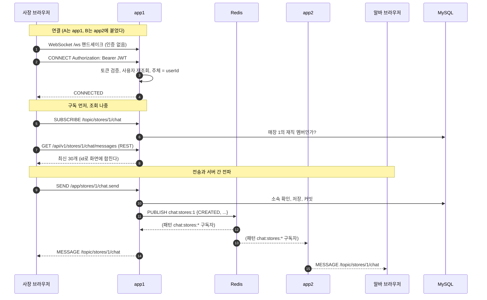

# 매장 단체 채팅 구조

매장 하나가 채팅방 하나다. 실사용자가 10명이 안 되는 단계라, 기능을 늘리기보다 흐름을 설명할 수 있는 단순한 구조를
골랐다. 이 문서는 메시지 하나가 어떤 길로 가는지와, 왜 그렇게 정했는지를 적는다.

- 코드: `chat/core` (`com.tothework.chat`), 스키마 `tw_chat`
- 서버 2대 로컬 재현: [`deploy/chat-test/README.md`](../deploy/chat-test/README.md)
- 배포 준비: [`chat-deployment.md`](chat-deployment.md)

## 통로

| 기능 | 통로 | 주소 |
|---|---|---|
| 이전 메시지 조회 | REST | `GET /api/v1/stores/{storeId}/chat/messages?before={id}&size=30` |
| 메시지 전송 | STOMP SEND | `/app/stores/{storeId}/chat.send` `{"content":"..."}` |
| 메시지 수정 | STOMP SEND | `/app/stores/{storeId}/chat.edit` `{"messageId":1,"content":"..."}` |
| 메시지 삭제 | STOMP SEND | `/app/stores/{storeId}/chat.delete` `{"messageId":1}` |
| 실시간 수신 | STOMP SUBSCRIBE | `/topic/stores/{storeId}/chat` |
| 개인 오류 수신 | STOMP SUBSCRIBE | `/user/queue/errors` |
| 붙은 서버 이름 | STOMP SUBSCRIBE | `/app/server-info` (한 번 응답) |
| WebSocket 엔드포인트 | - | `/ws` (SockJS 없음) |

실시간 이벤트 본문은 세 종류가 같은 주소로 흐른다.

```json
{ "type": "CREATED | UPDATED | DELETED",
  "message": { "id": 42, "storeId": 1, "senderId": 7, "senderName": "알바", "senderProfileImageUrl": null,
               "content": "오늘 마감 제가 할게요", "deleted": false,
               "createdAt": "2026-11-23T09:30:00", "updatedAt": "2026-11-23T09:30:00" } }
```

삭제된 메시지는 자리를 지키고 `content`가 `"삭제된 메시지입니다"`로 나간다(소프트 삭제).

## 흐름



1. **연결**: 핸드셰이크(HTTP)는 인증 없이 열고, 인증은 STOMP CONNECT 프레임에서 한다
   (`StompAuthChannelInterceptor`). HTTP 필터와 같은 `JwtTokens`로 검증하고, 사용자를 DB에서 다시 읽는다. 그래서
   탈퇴한 사용자의 토큰은 만료 전이라도 막히고, 추가 정보를 입력하지 않은 계정도 막힌다.
2. **구독**: SUBSCRIBE마다 주소의 storeId로 `StoreAccess.requireMember`를 부른다. 매장이 없거나, 멤버가 아니거나,
   퇴사했으면 거절한다. 알려진 주소(`/topic/stores/{id}/chat`, `/user/queue/errors`, `/app/server-info`)만 허용한다.
3. **전송**: SEND도 같은 소속 확인을 거친다. 컨트롤러가 서비스를 불러 저장하고, 트랜잭션이 끝난 뒤
   `ChatEventPublisher`로 방송한다.
4. **서버 간 전파**: `ChatEventPublisher`는 Redis 채널 `chat:stores:{storeId}`에 발행만 한다. 모든 서버는 시작할 때
   패턴 `chat:stores:*` 하나를 구독해 둔다(`ChatRedisConfig`).
5. **수신**: 각 서버의 `RedisChatSubscriber`가 채널 이름에서 storeId를 꺼내 자기 SimpleBroker로 보낸다. SimpleBroker는
   그 서버에 붙은 구독자만 알기 때문에, 각자 자기 손님에게만 전달한다.

## 왜 이렇게 했나

### 매장 = 방, 별도 방 엔티티 없음
방의 속성이 매장과 1:1이고 따로 관리할 것(이름, 참여자, 초대)이 없다. 참여자는 매장 소속(`store_members`)이 이미
정한다. 방 테이블을 두면 매장 생성·삭제와 맞춰야 할 것만 늘어난다. 매장이 완전히 지워지면 `StorePurgedEvent`를 받아
그 매장의 메시지를 지운다(`ChatPurgeListener`). 다른 서비스와 같은 방식이다.

### 통로 분리: 조회는 REST, 실시간은 STOMP
이전 메시지는 "요청하면 한 번 받는 것"이라 HTTP의 캐시·재시도·인증·호출 제한을 그대로 쓴다. STOMP로 조회까지 하면
요청-응답을 메시지 위에 다시 만들어야 한다. 실시간 통로는 "새로 생긴 것"만 흘린다.

### 저장 후 방송
커밋 전에 방송하면, 받은 사람은 보이는데 롤백되어 DB에는 없는 메시지가 생길 수 있다. 저장이 끝난 뒤에만 방송한다.
그 대가로 저장은 됐는데 방송이 실패하는 경우가 생긴다. 그때는 보낸 사람에게 알리고, 다른 사람은 조회로 복구한다
(아래 "Redis 장애").

### 방송은 한 클래스로만
`ChatEventPublisher`가 유일한 출구라서, 서버 1대(직접 전송)에서 2대(Redis)로 바꿀 때 이 클래스 하나만 바뀌었다.
컨트롤러나 서비스는 방송이 어떻게 전달되는지 모른다.

### 패턴 하나만 구독, 로컬 전송은 리스너 한 곳에서만
- 방(매장)마다 구독을 걸고 푸는 방식은 쓰지 않았다. 그러려면 서버마다 "지금 누가 어느 방에 있는지"를 추적해야 하고,
  구독을 거는 순간과 첫 메시지가 엇갈리면 놓친다. 모든 서버가 모든 매장의 이벤트를 받아도 지금 규모에서는 부담이
  없고, 받은 서버에 그 방 구독자가 없으면 아무에게도 가지 않을 뿐이다.
- 발행한 서버도 자기 구독자에게 직접 보내지 않고 Redis를 거쳐 받는다. 발행하면서 직접도 보내면 같은 서버에 붙은
  사람이 같은 메시지를 두 번 받는다.

### 오류 두 종류
| 종류 | 예 | 처리 | 결과 |
|---|---|---|---|
| 프로토콜 수준 | 토큰 없음·만료, 소속 아닌 매장 구독, 모르는 주소 | 인터셉터가 예외 → `StompErrorHandler`가 ERROR 프레임 | 연결 끊김 |
| 애플리케이션 수준 | 남의 메시지 수정, 빈 메시지, 없는 메시지, 방송 실패 | `ChatMessageExceptionAdvice`가 `/user/queue/errors`로(`broadcast=false`) | 연결 유지 |

권한이 없는 사람의 연결은 유지할 이유가 없어서 끊는다. 반면 입력 실수 하나로 연결을 끊으면 사용자는 재접속 동안
메시지를 놓친다. 그래서 비즈니스 오류는 ERROR 프레임으로 보내지 않는다. 두 경우 모두 본문은 HTTP와 같은
`ApiResponse` 형식(`success`, `message`, `code`)이다. 개인 오류는 Redis를 거치지 않는다. 요청이 들어온 서버에 그
세션이 있기 때문이다.

### 구독 먼저, 조회 나중 (클라이언트)
```
① SUBSCRIBE /topic/stores/1/chat   ─────────── 이 시점부터 오는 것은 모두 받는다
② GET .../chat/messages            ─────────── 이 시점까지 저장된 것을 받는다
③ 메시지 id로 합친다                 ─────────── ①과 ②에 모두 들어온 것은 한 번만 보인다
```
순서를 반대로 하면, 조회 응답이 온 뒤 구독이 걸리기 전 사이에 저장된 메시지는 어디로도 오지 않는다. 겹치는 것은
id로 합치면 되지만 빠진 것은 되찾을 수 없다. 재접속할 때도 같은 순서를 반복한다. 구독은 연결에 묶여 있어 끊기면
사라지므로 다시 걸어야 하고, 끊긴 동안의 메시지는 조회가 채운다. `chat-test.html`이 이 순서의 기준 구현이다.

### 연결 설정
- 하트비트 10초/10초: ALB의 유휴 타임아웃 안에 프레임이 오가게 해 연결이 끊기지 않게 한다.
- 전송 한도: 보내기 10초, 버퍼 512KB, 메시지 64KB. 느린 클라이언트 하나가 서버 메모리와 스레드를 붙잡지 않게 한다.
  메시지는 500자(코드 포인트 기준, DB `VARCHAR(500)`과 같다)라 64KB면 넉넉하다.
- 허용 Origin은 `*`가 아니라 설정값(`CHAT_ALLOWED_ORIGINS`, 기본은 CORS와 같은 프론트 주소)이다.

## 남은 일과 선택지

### 연결 중 액세스 토큰 만료 (TODO, 미구현)
지금은 CONNECT 시점에만 토큰을 본다. 액세스 토큰은 15분인데, 연결은 그보다 오래 유지될 수 있다. 탈퇴와 퇴사는
SEND·SUBSCRIBE마다 하는 소속 확인에서 막힌다. 다만 **이미 걸린 구독은 퇴사 뒤에도 그 연결이 살아 있는 동안 방송을
계속 받는다.**

| 선택지 | 방법 | 장단점 |
|---|---|---|
| A. 클라이언트 주기 재접속 | 프론트가 토큰을 갱신할 때 STOMP를 새 토큰으로 다시 연결 | 서버 변경 없음. 서버가 강제하지 못한다 |
| **B. 서버가 만료 시각 검사 (추천)** | CONNECT 때 토큰 만료 시각을 세션 속성에 넣고, 인터셉터가 SEND·SUBSCRIBE마다 확인. 지나면 ERROR → 클라이언트가 토큰 갱신 후 재접속 | 코드 몇 줄. 퇴사자의 구독도 최대 15분 안에 끊긴다. 클라이언트가 재접속 시 구독을 다시 거는 구조라 그대로 맞물린다 |
| C. 연결 안에서 재인증 | `/app/auth.refresh`로 새 토큰을 보내 세션 주체를 갱신 | 끊김이 없다. 직접 만들 부분과 검증할 경우가 많다 |
| D. 퇴사 시 강제 해제 | 퇴사 이벤트를 받아 그 사용자의 세션을 모든 서버에서 끊음(Redis로 전달) | 즉시 막힌다. 서버 간 세션 제어가 새로 필요하다 |

### Redis 장애 시 (현재: 알리고 조회로 복구)
지금은 발행에 실패하면 로그를 남기고 보낸 사람에게만 "저장됐지만 실시간 전달에 실패"를 알린다. 메시지는 DB에 있어서
다른 사람은 새로 고치거나 재접속할 때 받는다. Redis 연결 타임아웃은 2초라 전송이 오래 붙잡히지 않는다.

| 선택지 | 방법 | 장단점 |
|---|---|---|
| 현재 방식 | 실패를 알리고 조회로 복구 | 단순하다. Redis가 죽은 동안은 실시간이 멈춘다 |
| 로컬로만이라도 전송 | 발행이 실패하면 이 서버의 구독자에게라도 보냄 | 일부만 실시간으로 받아 사람마다 화면이 달라진다. 장애가 덜 드러나 늦게 알게 된다 |
| 아웃박스 + 재발행 | 방송할 이벤트를 저장해 두고 Redis가 돌아오면 다시 발행(Modulith 이벤트 발행 기록 활용) | 결국 다 전달된다. 중복이 생길 수 있지만 클라이언트가 id로 합치므로 해가 없다. 구현과 순서 보장 검토가 필요하다 |
| 클라이언트 보정 | 재접속하거나 오래 조용하면 최신 메시지를 다시 조회 | 서버 변경 없이 놓친 것을 채운다. 이미 재접속 때는 하고 있다 |

### 범위 밖 기능
- **채팅 전송 호출 제한**: HTTP의 `@RateLimit`은 STOMP 전송에 걸리지 않는다. 인터셉터에서 사용자별로 세면 된다.
  서버가 여러 대면 카운터도 Redis에 둔다.
- **읽음 표시·안 읽은 수**: 멤버별 `last_read_message_id` 한 줄이면 된다. 안 읽은 수는 `(store_id, id)` 인덱스로
  `id > last_read` 개수를 센다.
- **푸시 알림**: 앱이 꺼진 사람에게는 STOMP가 닿지 않는다. 메시지 저장 이벤트를 받아 FCM/APNs로 보낸다(접속 중인
  사람은 제외).
- **첨부·검색·입력 중 표시**: 첨부는 기존 S3 업로드를 재사용한다. 입력 중 표시는 저장하지 않는 이벤트로 같은
  주소에 흘린다.
- **삭제된 메시지 원문**: 소프트 삭제라 DB에는 원문이 남는다. 개인정보 요청에 대응해야 하면 삭제 시 내용을 비우는
  쪽으로 바꾼다.
